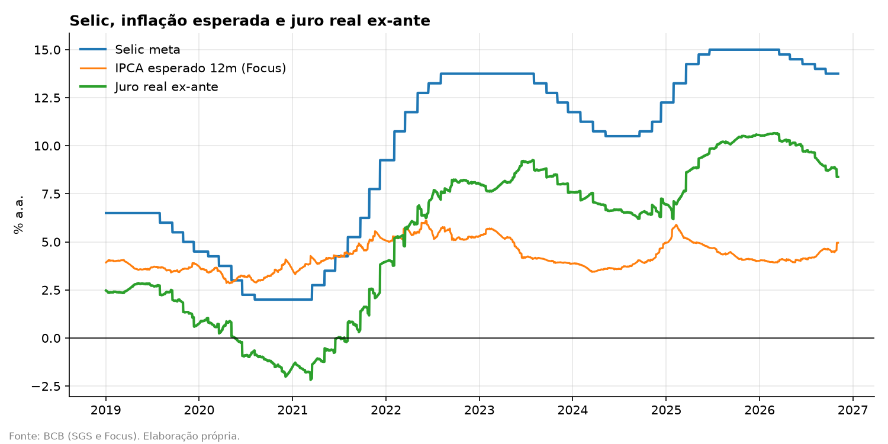
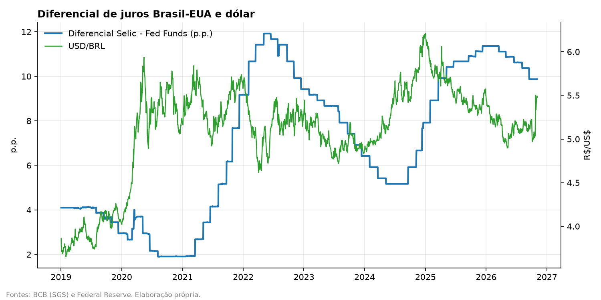
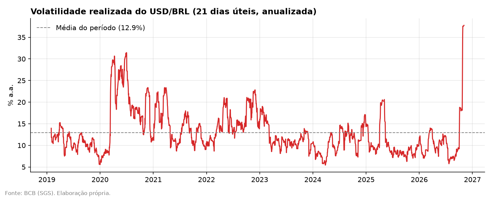

# Monitor de Juros e Câmbio — Brasil

Monitor em Python que coleta dados públicos do Banco Central do Brasil e do Federal Reserve, calcula indicadores de juros e câmbio e gera gráficos e uma tabela de dólar a termo teórico.

**Autor:** Marcus Gonçales Filho · Ciências Econômicas, PUC-SP

---

## O que o monitor acompanha

| Indicador | Fonte | Para que serve |
|---|---|---|
| Selic meta | BCB / SGS (série 432) | Postura da política monetária |
| IPCA esperado 12 meses | BCB / Focus | Expectativa de inflação do mercado |
| Juro real ex-ante | Cálculo próprio | Quão contracionista está a política monetária |
| Fed Funds efetivo | NY Fed (EFFR), com FRED como reserva | Juro de referência dos EUA |
| Diferencial Brasil–EUA | Cálculo próprio | Atratividade do carry trade em reais |
| USD/BRL | BCB / SGS (série 1) | Câmbio spot |
| Volatilidade do câmbio (21d) | Cálculo próprio | Risco percebido no real |
| Dólar a termo teórico | Cálculo próprio | Preço justo do termo pela paridade coberta |

## Leitura de conjuntura — novembro/2026

*Dados até 04/11/2026.*

| Indicador | 27/10 | 04/11 | Variação |
|---|---|---|---|
| Selic meta | 13,75% | 13,75% | igual |
| IPCA esperado 12m (Focus) | 4,53% | 4,96% | +0,43 p.p. |
| Juro real ex-ante | 8,82% | 8,38% | −0,44 p.p. |
| Fed Funds | 3,88% | 3,88% | igual |
| Diferencial BR–EUA | 9,87 p.p. | 9,87 p.p. | igual |
| USD/BRL | 5,3346 | 5,4778 | +2,7% |
| Volatilidade 21d | 37,6% | 37,8% | estável |
| Dólar a termo 12 meses | 5,8415 | 5,9983 | +0,16 |

**Juros.** Em 4 de novembro, o Copom manteve a Selic em 13,75% a.a., por unanimidade, e interrompeu uma sequência de cinco cortes de 0,25 p.p. O comitê elevou suas projeções de inflação para 5,6% em 2026 e 4,7% em 2027, ambas acima do teto da meta, e não indicou quando retomará os cortes. A semana já mostrava o motivo nos dados do monitor: a inflação esperada para os próximos 12 meses subiu de 4,53% para 4,96%, e o juro real ex-ante caiu de 8,8% para 8,4% mesmo com a Selic parada. Com expectativas piorando, o mesmo nível de Selic aperta menos a economia, e novos cortes afrouxariam ainda mais a política monetária.

**Câmbio.** O diferencial de juros entre Brasil e EUA seguiu em 9,87 p.p., mas o dólar subiu 2,7% na semana, para R$ 5,48 (taxa do BCB). Isso reforça a leitura de outubro: no momento, a percepção de risco pesa mais que o carry. A volatilidade realizada de 21 dias continua perto de 38% a.a., quase o triplo da média do período, mas parte desse número é efeito da janela de cálculo: o dia da alta de cerca de 8% após a eleição ainda está dentro dos 21 dias e deve sair da conta no fim de novembro.

**Proteção cambial.** Como os juros não mudaram, o prêmio do dólar a termo sobre o spot ficou igual: 4,6% em 6 meses e 9,5% em 12 meses. O termo de 12 meses subiu de 5,84 para 6,00 apenas porque o dólar de partida subiu. Para um importador, adiar o hedge ficou mais caro. Para um exportador, o termo continua pagando o diferencial de juros acima do spot.

**O que acompanhar.** A ata do Copom em 10/11 deve esclarecer as condições para retomar os cortes. Também importam a próxima reunião, em 8 e 9/12, a evolução do IPCA esperado no Focus e a queda da volatilidade quando o choque pós-eleição sair da janela de 21 dias.

## Leituras anteriores

### Outubro/2026

**Juros.** A Selic iniciou um ciclo de alta no fim de 2024 e chegou a 15% a.a. em meados de 2025, nível em que permaneceu até o início de 2026. Desde então, o Banco Central vem reduzindo os juros de forma gradual, e a meta está hoje em 13,75% a.a. Apesar dos cortes, a política monetária segue contracionista: descontada a inflação esperada para os próximos 12 meses (4,53%, segundo o Focus), o juro real ex-ante está em 8,8% a.a., bem acima das estimativas de juro neutro, em torno de 5%. Ou seja, o BC está aliviando o aperto, não estimulando a economia.

**Câmbio.** Com a Selic em 13,75% e o Fed Funds em 3,88%, o diferencial de juros entre Brasil e EUA está perto de 10 p.p., um nível historicamente elevado. Ao longo da série, diferenciais altos tenderam a sustentar o real pelo carry trade: foi assim em 2021–22 e novamente em 2025, quando o diferencial voltou a superar 10 p.p. e o dólar recuou para perto de R$ 5,00. Em outubro de 2026, porém, o diferencial alto não impediu um choque: após o segundo turno das eleições, o dólar subiu cerca de 8% em um único dia, e a volatilidade realizada de 21 dias saltou para 37,6% a.a., o maior nível da série e quase o triplo da média do período (12,8%). O episódio mostra que o carry protege o real em condições normais, mas perde força quando a percepção de risco fiscal e político aumenta. Pela paridade coberta, o dólar a termo de 12 meses fica cerca de 9,5% acima do spot, prêmio que reflete o diferencial de juros, e não uma expectativa de alta do dólar.

**O que acompanhar.** Três pontos devem orientar juros e câmbio nas próximas semanas. Primeiro, a reação do Copom: o choque cambial pode pressionar a inflação via preços de importados (pass-through), o que tende a desacelerar ou interromper o ciclo de cortes. Segundo, as expectativas do Focus: uma alta do IPCA esperado reduziria o juro real e enfraqueceria o argumento para novos cortes. Terceiro, a sinalização fiscal do próximo mandato e a política do Fed, que juntas determinam se o diferencial de juros volta a ser suficiente para atrair capital e reduzir a volatilidade do real.

## Gráficos







## Dólar a termo teórico

Pela paridade coberta de juros, o preço justo do dólar a termo é:

$$F = S \times \frac{(1 + i_{BR})^t}{(1 + i_{EUA})^t}$$

A tabela com os valores atuais fica em [`dados/dolar_a_termo.csv`](dados/dolar_a_termo.csv).

**Limitação:** o cálculo usa a Selic meta e o Fed Funds como taxa para todos os prazos (curva plana). Uma mesa de câmbio usa a curva de DI futuro para o lado brasileiro e o cupom cambial para o lado em dólar. A diferença entre o termo teórico e o negociado reflete justamente a inclinação dessas curvas e o risco-país.

## Como rodar

```bash
pip install -r requirements.txt
python monitor.py
```

O script baixa os dados, salva os CSVs em `dados/` e os gráficos em `graficos/`.

## Próximos passos

- Incluir a curva de DI futuro (B3) e comparar o termo teórico com o de mercado
- Atualização automática semanal
- Painel interativo
